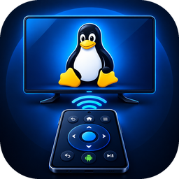
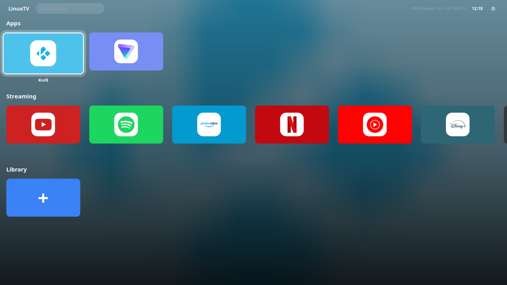
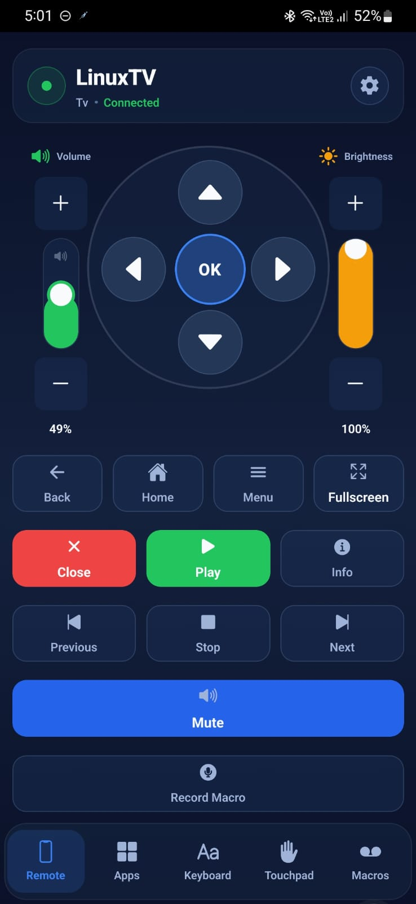

  
  <h1>LinuxTV</h1>

LinuxTV turns any computer into a simple TV box. Plug the computer into your TV, start it from a USB stick, and you get one big, easy screen with your favorite apps and websites (YouTube, Netflix, Kodi, VLC and more). You control everything from your phone, like a remote control. No keyboard, no mouse, no setup headaches.

  

## LinuxTV Remote

  

## Screenshots

| Desktop | Remote |
|---|---|
|  |  |

## Star History

<a href="https://www.star-history.com/?repos=guruswarupa%2Flinuxtv&type=date&legend=top-left">
 <picture>
   <source media="(prefers-color-scheme: dark)" srcset="https://api.star-history.com/chart?repos=guruswarupa/linuxtv&type=date&theme=dark&legend=top-left" />
   <source media="(prefers-color-scheme: light)" srcset="https://api.star-history.com/chart?repos=guruswarupa/linuxtv&type=date&legend=top-left" />
   
 </picture>
</a>

## What is it?

LinuxTV is a small operating system (the thing that runs a computer, like Windows) made just for TVs. Instead of a desktop full of tiny icons, you get one big, clean home screen with large app tiles that are easy to read from your couch.

It comes in two parts that work together:

- **LinuxTV** - the TV screen. It runs on the computer connected to your TV.
- **LinuxTV Remote** - a free Android app that turns your phone into the remote control. It's on [Google Play](https://play.google.com/store/apps/details?id=com.guruswarupa.linuxtvremote), and the APK file is also in the downloads if you prefer to install it yourself.

## Why not just buy a streaming stick?

Streaming sticks and smart TVs are easy, but they come with limits. LinuxTV is for people who want more:

- **It's a real computer.** Anything you can open in a web browser works: YouTube, Netflix, live sports, your school or work site, a cloud game, a kids' learning site. You are never stuck waiting for someone to publish an app for your device.
- **It's free.** No subscription, no hardware to buy if you already have an old PC or laptop.
- **Give old hardware a new life.** That dusty laptop in the cupboard becomes a smooth TV box.
- **You're in control.** Nothing is pushed at you. Your home screen has only the apps and sites you choose, arranged the way you like.
- **No tangled setup.** You don't install anything on the computer. Everything runs from the USB stick, so your PC's own files stay untouched, and removing the stick brings your old setup right back.
- **Built on Linux.** Linux is trusted around the world for being fast, stable and respectful of your privacy. It runs happily on modest computers that struggle with other systems, and it's free and open for anyone to look at and improve.
- **One phone, whole house.** Your phone is the remote, the keyboard and the mouse. No more hunting for batteries or typing a password letter by letter with arrow keys.

## What can it do?

**On the TV**
- Big, colorful app tiles that grow and glow as you move over them, so you always know what's selected
- A background that gently changes color to match the app you're pointing at
- Apps and websites side by side. Open Netflix, YouTube, Prime Video, Disney+, Spotify and many more, or add any site you like
- Play your own movies and music with apps like Kodi and VLC
- Search as you type to find an app instantly
- Mark favorites, move tiles around, and remove the ones you don't use
- Connect to Wi-Fi and Bluetooth speakers or headphones right from the TV screen
- Change the volume, screen brightness and sound output without leaving the couch
- Update the system with a single button in Settings
- Pick an app to open automatically after a few seconds of doing nothing, so it is ready to play the moment you turn it on (you can cancel it with a tap)

**On your phone**
- A touch remote with arrow keys, an OK button and a touchpad you can swipe like a laptop
- A full keyboard, including Ctrl, Alt, Shift, copy and paste, so typing a search or a password is quick
- Record a series of buttons once and replay it later with one tap (great for things you do every day)
- Volume and brightness sliders
- Add, remove and rearrange apps and websites from your phone
- Turn the TV box off or restart it without getting up
- Pair with a simple code shown on the TV, so only people you let in can control it

**Your stuff stays put**
- Because LinuxTV saves your settings, added apps and files on the USB stick, everything is still there the next time you turn it on

## What you need

- A computer you can connect to your TV (most PCs and laptops work)
- A USB stick (8 GB or more is a safe choice). Everything on it will be erased
- An Android phone for the remote (optional, but recommended)
- Another computer (Windows, Mac or Linux) to prepare the USB stick
- **A USB keyboard and mouse, just for the first setup.** You need them once to connect to Wi-Fi and to link your phone remote (see below). After that, your phone does everything. If your TV box is connected to the internet with a network cable, you can skip the Wi-Fi part.

## Get LinuxTV

- **LinuxTV and the remote app**: [download from GitHub](https://github.com/guruswarupa/LinuxTV/releases/tag/latest) (also on [SourceForge](https://sourceforge.net/projects/linuxtv/files/release/))
- **Flash tool**: `LinuxTV-Flash-Tool.zip` from the same page. It is a small friendly program that puts LinuxTV on your USB stick in a few clicks. See [`iso-builder/USB-GUIDE.md`](iso-builder/USB-GUIDE.md) for step-by-step help.
- **Phone remote**: [get it on Google Play](https://play.google.com/store/apps/details?id=com.guruswarupa.linuxtvremote) or install the APK from the downloads page.

## How to set it up

### 1. Put LinuxTV on a USB stick (on your Windows, Mac or Linux computer)

1. Download `LinuxTV.iso` and `LinuxTV-Flash-Tool.zip`, then unzip the flash tool.
2. Open the flash tool, choose the ISO file and your USB stick, and click **Flash**. Wait until it says it's ready.

### 2. Start the TV box from the USB stick

1. Plug the USB stick into the computer you'll use as your TV box and turn it on. You may need to pick the USB stick from the boot menu (see the key table below).
2. **The first time, LinuxTV restarts once by itself.** It is setting up the space that saves your settings and files. This is normal and only happens once. Don't unplug the USB stick, and just wait for it to come back.

### 3. First-time setup (keyboard and mouse needed once)

The very first time, your phone can't control the TV box yet, so plug in a USB keyboard and mouse (or use the computer's own keyboard and touchpad):

1. **Connect to Wi-Fi.** On the LinuxTV home screen, open **Settings** and choose **Network**. Pick your Wi-Fi, type the password, and connect. (Skip this if you use a network cable.)
2. **Find the TV box's address.** Look at the top bar of the home screen. It shows an IP address, a number like `192.168.1.25`.
3. **Link your phone.** Install the LinuxTV Remote app (see the download links above), open it, type in that address, and connect. Your phone must be on the same Wi-Fi as the TV box. If it asks for a pairing code, you can find it in **Settings** under **Remote Control** on the TV.

Once the phone is connected, put the keyboard and mouse away. From now on, your phone is all you need, and LinuxTV remembers your Wi-Fi.

### 4. Make the USB stick start automatically

So LinuxTV starts every time you turn the TV box on, with no menu to pick from, make the USB stick the first boot option:

1. Turn the computer on and press the startup settings key (BIOS/UEFI), usually F2, F10, F12 or Del.
2. Find the **Boot** section (sometimes called Boot Order or Boot Priority).
3. Move your USB stick to the top of the list. It may be shown as "USB HDD", "USB Storage" or the stick's brand name.
4. Save and exit (usually F10).

Keep the USB stick plugged in. If it is ever removed, the computer simply starts its normal system instead.

#### Which key do I press?

Press the key right as the computer turns on, and tap it a few times (don't hold it). **BIOS / UEFI setup** is where you change the boot order for good. The **boot menu** lets you pick the USB stick just once.

| Brand | BIOS / UEFI setup | Boot menu (one time) |
|---|---|---|
| Acer | F2 or Del | F12 |
| ASRock | F2 or Del | F11 |
| ASUS | F2 or Del | F8 (laptops: Esc) |
| Dell / Alienware | F2 | F12 |
| Fujitsu | F2 | F12 |
| Gigabyte / Aorus | Del | F12 |
| HP | Esc, then F10 | Esc, then F9 |
| Huawei | F2 | F12 |
| Intel NUC | F2 | F10 |
| Lenovo (ThinkPad, IdeaPad, ThinkCentre) | F2 or F1 (some laptops: Fn + F2) | F12 (some IdeaPads also have a small "Novo" button) |
| LG | F2 | F10 or F12 |
| MSI | Del | F11 |
| Samsung | F2 | Esc or F12 |
| Toshiba / Dynabook | F2 | F12 |
| Framework | F2 | F12 |
| Microsoft Surface | Hold Volume Up while pressing the power button | Hold Volume Down while pressing the power button |
| Apple Mac (Intel only) | Not used | Hold the Option (Alt) key |
| Other / custom-built PC | Del or F2 | F12, F11 or F8 |

Not sure, or the key doesn't work? These keys can differ between models, so check the manual or the logo screen, which sometimes shows "Press F2 to enter setup". A few more tips:

- **Windows PC that starts too fast for the key?** Hold **Shift** while clicking **Restart**, then choose **Troubleshoot > Advanced options > UEFI Firmware Settings**. For a one-time USB start, choose **Use a device** instead.
- **USB stick not listed?** Turn **Secure Boot** off in the BIOS/UEFI settings and try again. See [`iso-builder/USB-GUIDE.md`](iso-builder/USB-GUIDE.md) for more help.
- **Apple Silicon Macs** (M1 and newer) can't start from a USB stick like this.

That's it. Pick an app and enjoy.

### Check your download (optional)

Each download has a checksum file next to it that lets you confirm it wasn't damaged or changed. On Windows, run `certutil -hashfile LinuxTV.iso SHA256` and compare the result with the number in `LinuxTV.iso.sha256`.
